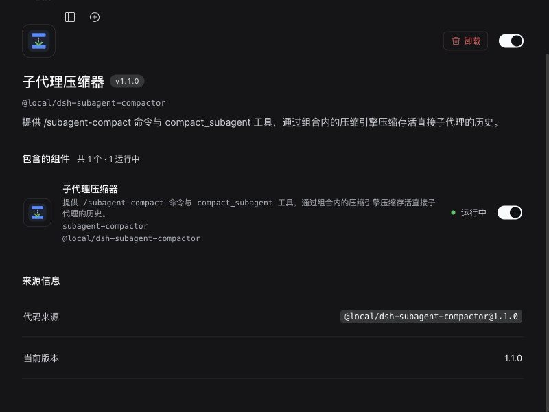
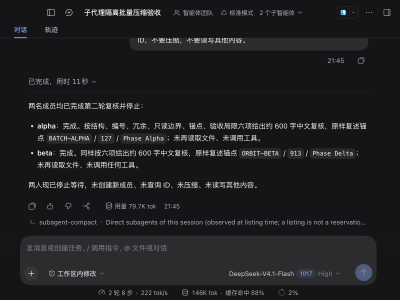
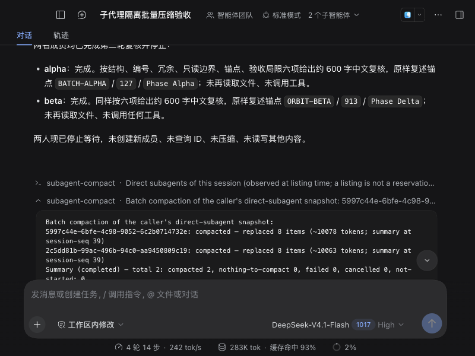
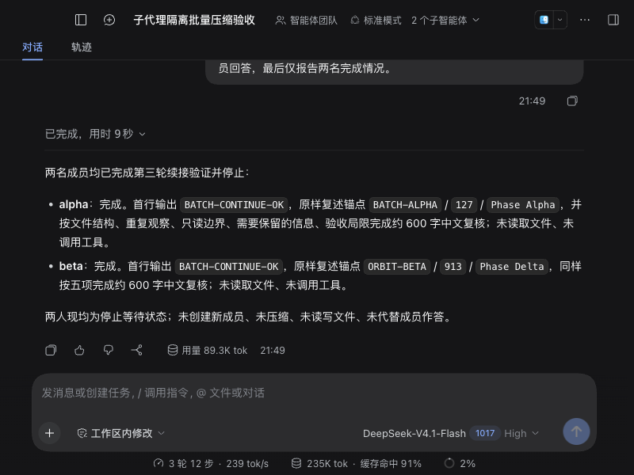
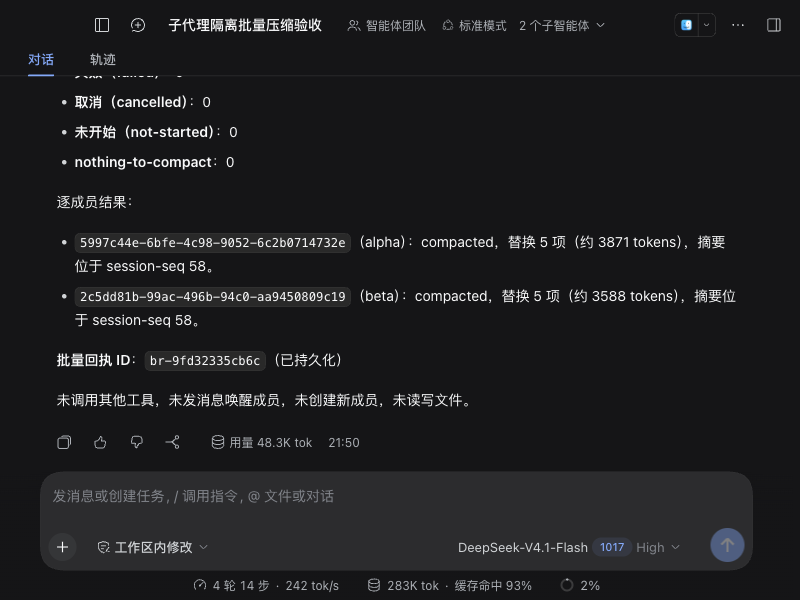
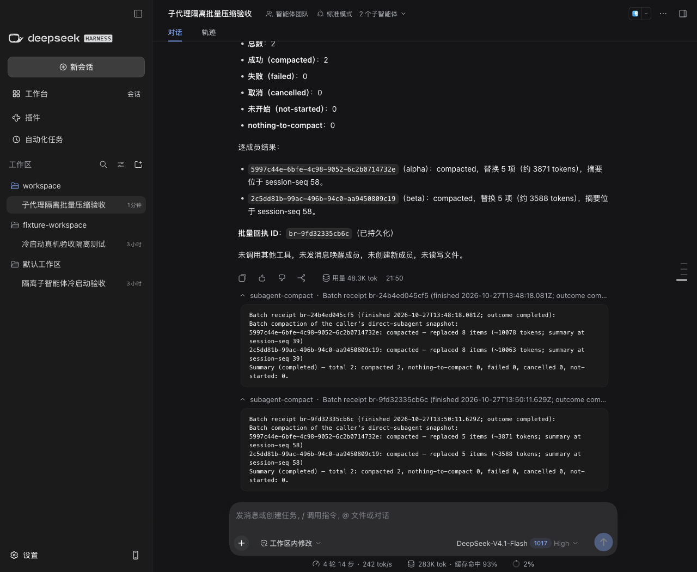

# 批量压缩子会话：Desktop 隔离验收

日期：2026-10-27。执行与独立复核：砚砚61 / gpt-6.1-sol。

**验收通过。** 在带候选宿主补丁的 Desktop 副本中，`/subagent-compact --all` 和 `compact_all_subagents({})` 均成功压缩两个已结束的 continuable 子会话；原 ID 续接保留事实，完整重启后两份批量回执仍可查询。

**使用前提：冷压缩依赖候选宿主维护接口。原版 Harness 0.2.1-rc.2 缺少该接口，仅升级插件不能获得这项能力。1.1.0 仍为未发布候选，当前发布版为 1.0.1。**

## 验收对象

| 对象 | 实际范围 |
|---|---|
| 插件 | `@local/dsh-subagent-compactor` 1.1.0，提交 `804c9d997cf27ff3711d073af4a893a8481dcdeb` |
| 代码复审 | 批量与存储实现批准于 `eac0f12`；`804c9d9` 只修正 zod 的打包归属并补测试、文档，运行代码逐字节不变 |
| Desktop | 0.12.1 独立副本，独立 development profile、存储、日志和 loopback 端口 |
| 宿主 | Harness 0.2.1-rc.2，基线 `687f282e8625c6b8d11ff58211a90524be2e4317`，使用已复审的候选维护补丁 |
| 实际产物 | 两个已审 JS 模块的等价补丁装入副本 ASAR；未进行完整 monorepo 源码构建 |
| 模型 | 真实 `deepseek-official / deepseek-flash`；界面显示 DeepSeek-V4.1-Flash 1017，本次没有假模型 |
| 数据 | 专用工作区内两份只读合成文件 alpha.md、beta.md；父、子会话的持久化 cwd 均匹配该工作区 |

插件通过官方“插件 → 添加插件”界面从本地目录安装并启用。首次安装因 zod 被错误声明为 peer 而遭闭包校验拒绝；修复为固定版本的常规依赖后，安装成功。活动 generation 为 `local+dsh-subagent-compactor+1.1.0+14cfd1f0f714`，zod 4.4.3 从该 generation 自身解析。

## 实际操作与结果

1. Lead 创建 alpha、beta 两名 fresh continuable 成员。每名只读取自己的合成文件，完成两轮实质审阅后结束。
2. 人工执行裸 `/subagent-compact`，界面确认两个成员均为 `persisted (not loaded)`。没有派新任务维持 live 窗口。
3. 人工执行 `/subagent-compact --all`。真实命令管线返回 `success`，两项均 compacted，生成第一份持久回执。
4. Lead 通过正常 `send_message` 续接原成员，问题不附答案。两个成员在原 ID 下复述三项正确事实，各自这一轮工具调用数为 0。
5. 两名再次结束后，人工列表再次确认 not loaded；要求 Lead 仅调用一次 `compact_all_subagents({})`。日志记录真实模型工具调用，两项均 compacted，生成第二份独立回执。
6. 完整退出副本进程 12333，再启动新进程 14995。人工分别执行两次 `report <batch-id>`，成功返回两份原始完整报告，文本与磁盘记录一致。

父会话：`session-89b278a8-6341-4079-bf4f-f9858e50d348`。

| 成员 | 原会话 ID | 首次批量 | 工具批量 | 同 ID 续接 |
|---|---|---|---|---|
| alpha | `5997c44e-6bfe-4c98-9052-6c2b0714732e` | 子日志 start 37 / summary 39 / end 41，替换 8 项 | start 56 / summary 58 / end 60，替换 5 项 | turn 3 / seq 52，三项事实正确、零工具 |
| beta | `2c5dd81b-99ac-496b-94c0-aa9450809c19` | 子日志 start 37 / summary 39 / end 41，替换 8 项 | start 56 / summary 58 / end 60，替换 5 项 | turn 3 / seq 52，三项事实正确、零工具 |

两次批量的子压缩区间均不重叠，符合串行执行。每次真实摘要调用使用子成员自己的 DeepSeek 路由，且有非空替换跨度、无压缩错误。

手动批量的父日志是 `seq 89 command/run → seq 90 command/done(success)`，期间没有模型工具代执行。模型工具批量是 `seq 134 tool/call → seq 135 tool/result`，工具结果未标错误。

## 事实保留与请求输入

续接请求没有提供答案，也没有重新读取文件。alpha 回答 `BATCH-ALPHA / 127 / Phase Alpha`，beta 回答 `ORBIT-BETA / 913 / Phase Delta`；两者首行均为 `BATCH-CONTINUE-OK`。

比较首次批量前最后一个子模型请求（seq 33）与之后第一个请求（seq 52）。总输入使用 API usage 的不相交计数 `inputTokens + cacheReadTokens + cacheWriteTokens`，不含输出。

| 成员 | 压缩前总输入 | 压缩后总输入 | 净差 | 降幅 |
|---|---:|---:|---:|---:|
| alpha | 22,103 | 16,664 | 5,439 | 24.61% |
| beta | 22,024 | 16,472 | 5,552 | 25.21% |

这些净差包含新摘要及新增续接消息的影响，不能称为纯压缩节省。首次结果中的 10,078 / 10,063 tokens、第二次的 3,871 / 3,588 tokens 都是被替换旧历史的估算值，与上表含义不同。合成文件刻意冗余，本次降幅不代表普通任务的压缩率。

## 重启后回执查询

回执存储在插件自有 `subagent_compactor_batch_receipts` 域的真实 JSON 介质中，每条记录带父会话 ID，以 `<parentSessionId>:<batchId>` 为键；本次父会话日志中 `plugin:` 记录数为 0。

| 回执 | 批量终态 | 计数 | 重启后父日志查询 |
|---|---|---|---|
| `br-24b4ed045cf5` | completed | total 2 / compacted 2，其余 0 | run 143 / done 144，success |
| `br-9fd32335cb6c` | completed | total 2 / compacted 2，其余 0 | run 145 / done 146，success |

两份记录同时存在，后批没有覆盖前批。重启边界为父日志 seq 141；上述两次查询均发生在边界之后，且完整报告逐项文本与原记录一致。

## 复核范围与剩余边界

- 自动回归：存储迁移后的完整套件 82/82；最终纯打包修复的单测 45/45。最终包没有无理由重跑完整套件。
- 独立只读验收脚本核对了真实命令/工具日志、串行区间、正确事实与未附答案、实际 usage、磁盘回执、重启进程、活动 generation 和依赖闭包。机器证据见 [evidence.json](evidence.json)。
- 两份合成文件 SHA256 前后相同。正式安装包 `/Applications/DSH Desktop.app` 的 ASAR SHA256 仍为 `366bef4146e0a41227c6c96b39e621f21b08b93aeb7e21d5fc18bb5358fefaaa`；日常 profile 未用于试验。
- 取消、混合失败、跨父隔离、fork、并发和卸载交错由独立自动回归覆盖；本次 GUI 旅程证明两个目标的正常成功路径与重启回执，不冒充这些交错的逐项 GUI 实测。
- 验证的是补丁版副本，完整源码构建仍未做。原版宿主的 cold 项会明确返回 `host-capability-missing`；live 路径保持可用。
- 1.1.0 尚未合 main、打 tag 或发布；宿主能力的上游接入或专用补丁版维护路线尚未确定。

截图来自实际 UI；手动命令卡和重启回执卡在重启后展开以便阅读。公开材料仅包含合成验收结果与筛选后的事实，真实 profile、凭证和原始会话日志留在本机隔离验收目录。
