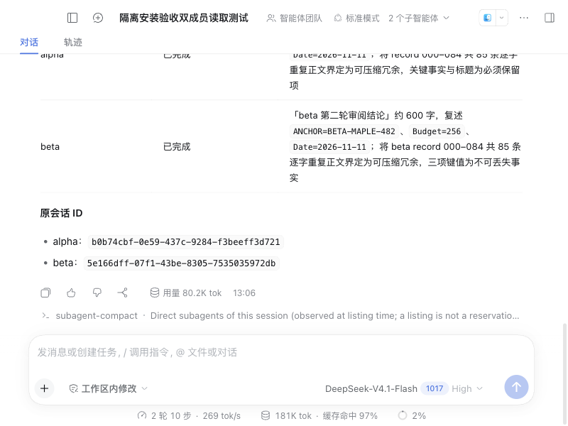
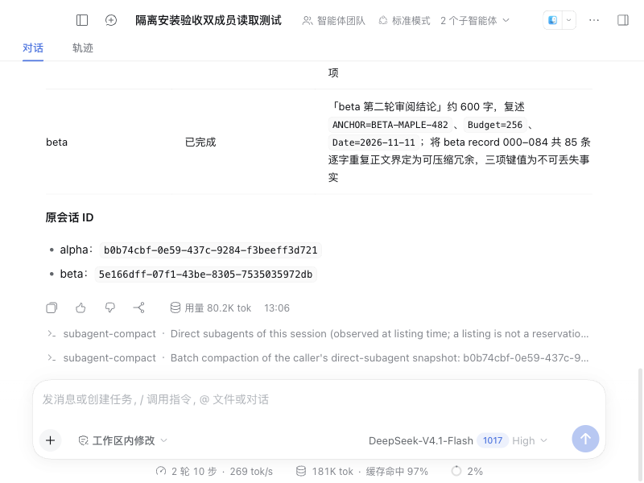
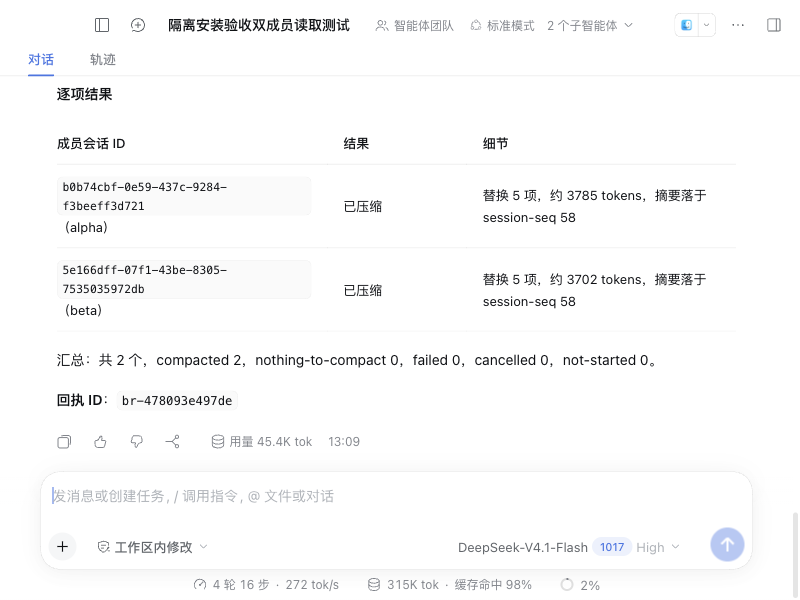
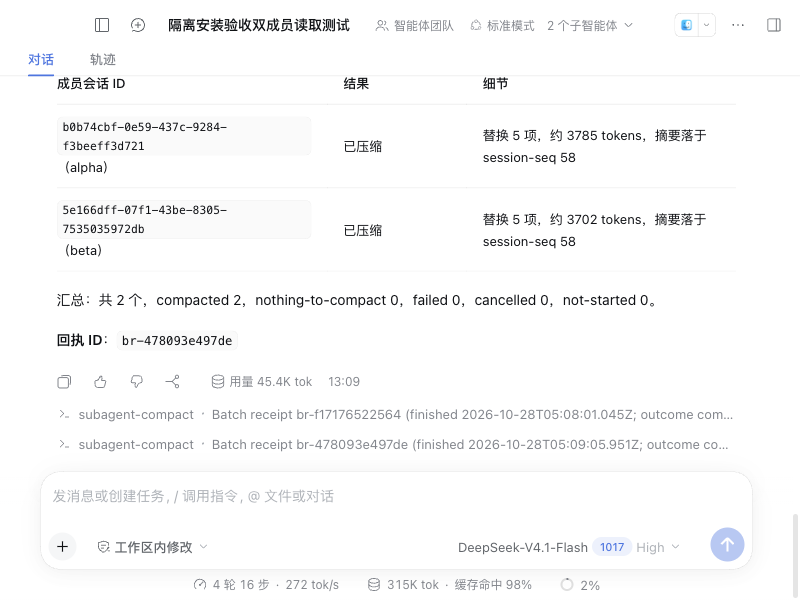

# 可移植 Desktop 安装链路：真实验收通过

验收日期：2026-10-28。安装器候选：`cba93e56b1a1dab211e4996dee74c602608a55fa`。这次从仓库中的制作脚本出发，经官方插件界面安装，完成真实模型双子会话冷批量、原 ID 续接和完整进程重启后回执查询；不再依赖上一轮本机私有 prepare 脚本或预先打补丁的模块树。

## 环境与安装

- macOS arm64；官方 Desktop 0.12.1、Harness 0.2.1-rc.2。制作脚本直接从官方 ASAR 抽取原版模块并应用仓库 0002/0003。
- 全新 clone 的依赖由 `npm ci --include=dev` 安装；制作、体检与签名校验通过。安装器定向套件 22 项：21 通过、1 平台跳过。
- 首启明确点击“从空白开始”，`.web-import-decision.json` 为 `skipped`。通过目录选择器选择新建的合成验收工作区，不使用 Desktop 的共享默认工作区。
- 在官方“插件 → 添加插件”界面输入 clone 的本地绝对路径，安装并启用 1.1.0。活动 generation 为 `local+dsh-subagent-compactor+1.1.0+c81ccf443e5e`，zod 4.4.3 从插件自身 generation 解析。
- 新副本按其 Messages 协议配置真实 `deepseek-official / deepseek-flash`。使用经 operator 授权的 API 账户及进程级代理；没有改全局网络、账户配置、原版应用或日常 profile。密钥不在本记录、截图或仓库中。

## 完整操作

1. 父会话创建 alpha、beta 两名 fresh continuable 成员，分别只读一份合成文件，完成两轮实质工作。
2. 人工运行裸 `/subagent-compact`，两名均显示 `persisted (not loaded)`。
3. 人工运行 `/subagent-compact --all`，两名均 compacted，回执 `br-f17176522564` 落盘。
4. 通过正常 `send_message` 向两个原 ID 提问，输入不携带答案；两名均不使用工具而答对 ANCHOR、Budget、Date。
5. 成员再次结束后，真实父模型仅调用一次 `compact_all_subagents({})`，两项均 compacted，第二份回执 `br-478093e497de` 落盘。
6. 完整退出 Desktop 进程 68626，确认退出后启动进程 73089。人工分别执行两个 `report <batch-id>`，得到完整原始报告；与存储域记录的文本逐字一致。

父会话：`session-91aa6b57-c38e-4c4b-a994-497cc14a7bf4`。

| 成员 | 原 ID | 人工批量 | 模型工具批量 | 压缩后续接 |
|---|---|---|---|---|
| alpha | `b0b74cbf-0e59-437c-9284-f3beeff3d721` | summary 39，替换 8 项 | summary 58，替换 5 项 | 三项事实正确，零工具 |
| beta | `5e166dff-07f1-43be-8305-7535035972db` | summary 39，替换 8 项 | summary 58，替换 5 项 | 三项事实正确，零工具 |

人工入口对应父日志 `command/run 102 → command/done 103(success)`；模型入口对应 `tool/call 145 → tool/result 146`。重启边界为 seq 152，两次查询为 154/155 与 156/157。两轮压缩均按子项串行执行，summary 记录真实模型流调用；没有向会话日志写插件回执记录。

## 实际请求与边界

首次压缩前最后一个子模型请求与压缩后第一个请求的输入计数（`inputTokens + cacheReadTokens + cacheWriteTokens`）：alpha 19,969 → 16,537；beta 20,878 → 16,425。差值包含摘要与续接输入的影响，不能当成独立的纯压缩收益。

两份合成文件与准备时内容一致；父子 cwd 均为专用工作区，子工具仅有对应文件的 read。回执属于本父会话，存储域版本为 1，重启后逐字查询成功。筛选后的证据见 [evidence.json](evidence.json)；原始会话、凭证与本机路径留在隔离验收目录。

原版 `app.asar` 前后 SHA256 均为 `366bef4146e0a41227c6c96b39e621f21b08b93aeb7e21d5fc18bb5358fefaaa`。本轮安装产物的插件 index、agent-loop 和 subagent 模块与上一轮真实冷批量验收产物逐字节一致。

此结论适用于上述受门禁约束的 macOS 副本；不表示原版 Desktop 单装插件即可冷压缩。没有完整构建 Harness monorepo、没有重新分发官方应用二进制，也没有创建 1.1.0 tag/release。公开分支、PR 和 main 的状态应以 GitHub 实况为准。
